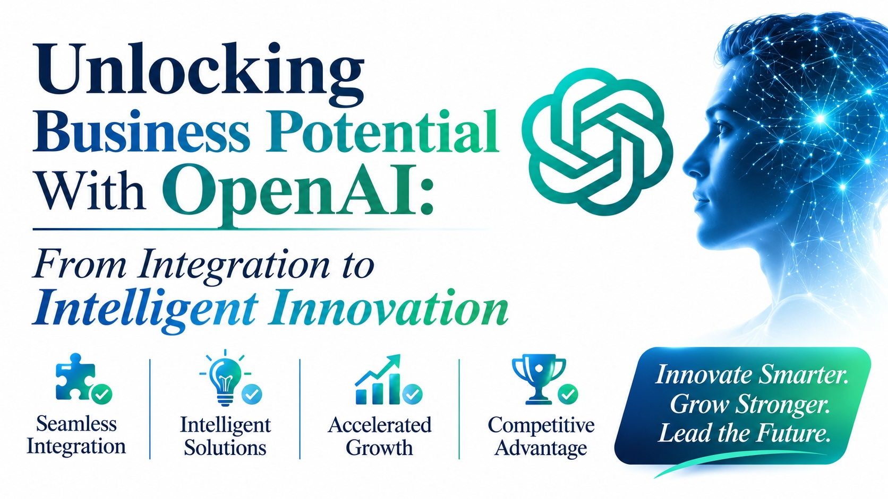

# Unlocking Business Potential With OpenAI: From Integration to Intelligent Innovation



Calling a model from code takes an afternoon. Running that call safely inside a business takes planning: which data may be sent, who may ask, what happens when an answer is wrong, and what each request costs. This playbook covers those questions in the order teams usually meet them.

Organizations that rely on [Enterprise OpenAI Development Solutions](https://zignuts.com/ai-services/ai-integration/openai-integration-services?utm_source=seo_web2.0&utm_medium=backlink&utm_campaign=seo_referral&utm_id=11) usually settle the integration pattern first, because it decides the data flow, the controls, and the cost profile of everything built afterward.

Treat the tables as starting points, and check the provider's current terms, data handling, and limits before you commit.

---

## Integration Patterns

| Pattern | Use it when | Watch for |
|---|---|---|
| **Direct request** | The task needs only the user's own input | Sensitive data leaving your boundary |
| **Retrieval over company data** | Answers must come from approved documents | Stale content and permission gaps |
| **Tool calling** | The model must read from or act on your systems | Actions that need approval |
| **Workflow automation** | A model step sits inside a larger process | Failures in the steps around it |
| **Batch processing** | Large volumes can wait for results | Cost and error handling at scale |

## A Minimal Request Flow

```
User request
    -> check identity and permissions
    -> mask or remove sensitive data
    -> retrieve approved context
    -> call the model
    -> check the answer against rules
    -> return it with sources, and log the outcome
```

## Evaluation Plan

1. Collect real examples of the task, including difficult ones.
2. Agree what a good answer looks like, and who decides.
3. Score the model on those examples before launch.
4. Re-run the same set whenever the model, prompt, or data changes.
5. Review a sample of live answers every week.

## Cost Control

- Record cost per request and per team from day one
- Set limits and alerts before wide release
- Send simple tasks to lighter models and keep stronger ones for hard cases
- Cache answers that repeat, where it is safe to do so

## Security Checklist

- [ ] Keys are stored in a secrets manager, never in code
- [ ] Access follows each user's existing permissions
- [ ] Sensitive data is masked before it is sent or logged
- [ ] Prompts and answers are logged for review, with limited access
- [ ] A person approves any action with real consequences
- [ ] There is a fallback when the service is slow or unavailable

---

**Ready to integrate OpenAI the right way?** Visit [zignuts.com](https://zignuts.com/?utm_source=seo_web2.0&utm_medium=backlink&utm_campaign=seo_referral&utm_id=11) to speak with the team.
